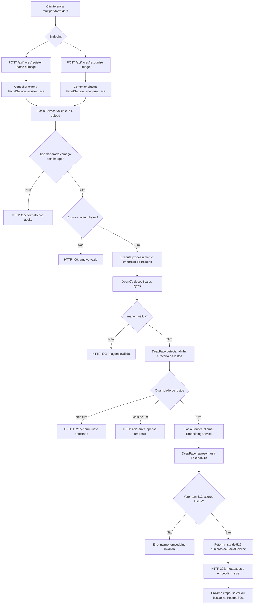

# Fluxo das funcionalidades faciais

## Estado atual

A API recebe uma imagem, valida o upload, detecta e recorta um rosto e gera um embedding de 512 valores. Os endpoints de cadastro e reconhecimento compartilham esse processamento.

O código foi implementado, mas a execução com os modelos ainda não foi validada: o interpretador apontado pelo ambiente virtual não foi encontrado na tentativa de verificação. A instalação das dependências e uma execução com imagens reais ainda são necessárias.

## Fluxograma

O diagrama abaixo usa Mermaid. Abra este arquivo em um visualizador Markdown com suporte a Mermaid para ver o fluxograma renderizado.



A seta pontilhada representa uma etapa pendente. O banco ainda não participa desse fluxo.

## Responsabilidade de cada arquivo

| Arquivo | Responsabilidade |
| --- | --- |
| `app/routers/faces.py` | Receber os campos HTTP e delegar ao service. |
| `app/services/facial_service.py` | Validar e ler o upload, recortar o rosto e coordenar a geração do embedding. |
| `app/services/embedding_service.py` | Gerar e validar o vetor FaceNet512. |
| `requirements.txt` | Declarar as dependências necessárias. |

As rotas não contêm a lógica de processamento. O `FacialService` cria uma instância de `EmbeddingService` e chama seu método `gerar_embedding` depois do recorte. O `EmbeddingService` não chama o `FacialService` de volta.

## Funcionalidades implementadas

### Recebimento da imagem

O cadastro recebe os campos obrigatórios `name` e `image`; o reconhecimento recebe somente `image`. Uma foto capturada pela câmera do navegador pode ser enviada como `Blob` ou `File`, dentro de um `FormData`.

O FastAPI recebe o arquivo como `UploadFile`. O método `_read_image` confere o tipo declarado pelo cliente e lê os bytes com `await image.read()`. Campos obrigatórios ausentes geram a resposta de validação `422` do FastAPI.

### Decodificação e recorte

O método `recortar_rosto` usa `cv2.imdecode` para converter os bytes em uma imagem. Isso também permite rejeitar conteúdo que não pode ser decodificado, mesmo que o cliente declare um tipo `image/`.

Em seguida, `DeepFace.extract_faces` usa o detector OpenCV, com detecção obrigatória e alinhamento habilitado. A aplicação aceita exatamente um rosto e retorna seu recorte em BGR, sem normalizar os pixels nessa etapa.

DeepFace é a biblioteca que coordena as operações; OpenCV é o detector escolhido para localizar os rostos.

### Geração do embedding

O `EmbeddingService.gerar_embedding` chama `DeepFace.represent` com:

| Configuração | Valor | Motivo |
| --- | --- | --- |
| `model_name` | `Facenet512` | Gerar um vetor com 512 dimensões. |
| `detector_backend` | `skip` | Receber diretamente o rosto já recortado. |
| `enforce_detection` | `False` | Não exigir uma segunda detecção no recorte. |
| `normalization` | `Facenet2018` | Aplicar a normalização escolhida para a entrada do modelo. |

O resultado é convertido em uma lista de números. Antes de retorná-lo, o service verifica se existem exatamente 512 valores e se todos são finitos. Um resultado inválido gera `RuntimeError`, atualmente sem tratamento HTTP específico.

O embedding representa características do rosto para uma futura comparação numérica. Ele não é, por si só, o nome ou a identidade de uma pessoa.

### Execução do processamento

Os métodos de cadastro e reconhecimento usam `run_in_threadpool` para executar o recorte e a geração do vetor em uma thread de trabalho. Assim, essas operações síncronas não ocupam diretamente o loop assíncrono da API.

A requisição aguarda o processamento terminar. Não foi criada uma fila ou tarefa em segundo plano.

## Respostas atuais

Ambos os endpoints retornam `202 Accepted` após gerar o embedding. O cadastro também devolve `name`; os dois devolvem `filename`, `bytes_received`, `embedding_size` e uma mensagem sobre a integração pendente.

Exemplo de resposta do cadastro, com valores ilustrativos:

```json
{
  "message": "Embedding gerado; cadastro ainda não foi salvo no banco.",
  "embedding_size": 512,
  "name": "Gabriel",
  "filename": "foto.jpg",
  "bytes_received": 45210
}
```

O vetor completo é usado internamente e não é devolvido na resposta. Como ainda não há persistência, ele é descartado ao fim da requisição. O endpoint de reconhecimento ainda não identifica uma pessoa: ele prepara o vetor para uma futura busca.

## Dependências e execução

Além de `python-multipart`, necessário para uploads, foram adicionados `deepface`, `tf-keras`, `numpy` e `opencv-python`.

Com um ambiente Python válido, instale as dependências a partir da pasta `API`:

```powershell
python -m pip install -r requirements.txt
```

O primeiro uso do modelo pode baixar seus pesos. Depois de iniciar a API, os uploads podem ser enviados pela interface `/docs` ou pelo frontend.

## Próximas etapas

1. Validar o processamento com imagens reais e conferir os erros de detecção.
2. Configurar a conexão SQLAlchemy com o PostgreSQL e as migrations Alembic.
3. Persistir nome e embedding no cadastro.
4. Implementar a busca por similaridade no reconhecimento e definir um limite para aceitar uma correspondência.
5. Definir limites de upload e tratamento dos erros de carregamento ou execução do modelo.

Ainda não foram implementados autenticação, detecção de vivacidade ou proteção contra fotos apresentadas à câmera.
